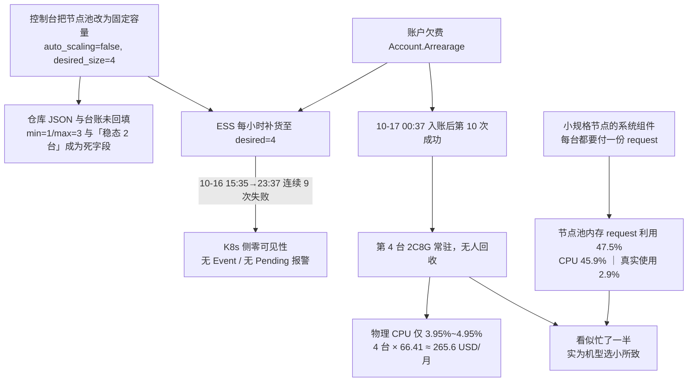

# 雅加达 dev 集群「物理空转 + 单节点 15 Pod」取证与整改

> 核实日期：2026-10-17 ｜ 账号：`5108890064395960` / `RAMUser: yanxuewei` ｜ CLI：aliyun-cli 3.5.1 ｜ 地域：`ap-southeast-5`
> 对象：集群 `cb0abf5bc06034f7bbdb991752f6f3e62`（`ack-newapi-jkt-dev`）/ 节点池 `npd3cc9d7f0503472f85420d30436269b5`（`np-jkt-dev-app`）/ 伸缩组 `asg-k1a59qtckc246wh9r3ay`
> **⚠ 18:0x WIB 复核：上述节点池已被重建替换**，现池 `np-jkt-dev-x4c` / `np72446b422a6441c0bc96762a796aed26`，单一 `ecs.g9i.xlarge`、`min=max=2`、按量。本文 §四 整改脚本与 §七 待拍板项因此作废（保留作取证过程），计费方式的选择见 **§八**。
> 取证脚本：[deploy/scripts/jkt-dev-recon.sh](../scripts/jkt-dev-recon.sh)（只读） ｜ 整改脚本：[deploy/scripts/jkt-dev-remediate.sh](../scripts/jkt-dev-remediate.sh)（默认 DRY-RUN）
> 证据分级：**C** = 本账号 API 实测 ｜ **A** = 官方文档交叉印证 ｜ **B** = 官方单一文档 ｜ **D** = 待实测/待目视

---

## 一、结论速览

> **§七（2026-10-17 追加）**：负责人提出的两项优化（按 P95 下调 requests、节点池定时伸缩）核实后的结论、成本账与待拍板项。**要点有三**：① 用带口径的节点池大盘复看后，**本文早先那个「Request 83%」读数不成立**（实为 request 利用 47.5%／使用率 2.9%），因此**优化 ① 的前提失效**，正文相关处已标注更正；② 定时伸缩只能用 ACK `desired_size`（ESS 定时任务是官方高危），且与恢复弹性伸缩互斥；③ 复看还发现**期望节点数 3／实际 2 台**的新漂移，优先级高于前两项。**三项均未执行。**

> **§八（同日 18:0x 追加，最新）**：节点池已被重建（现池 `np-jkt-dev-x4c` = 单一 `ecs.g9i.xlarge`、`min=max=2`、按量）⇒ **§四 整改脚本与 §七 P0–P6 作废**，上面那三条不再拍板。新问题是「按量转包年包月能省多少」，已用 `DescribePrice` 实测：按量 **157.19 USD/台/月**，1 年包折月 **95.83（省 39%，2 台年省约 1,473 USD）**，3/6 个月包**无叠加折扣**；另有 5 条官方转换约束（存量节点要单独转、云盘不能一起转、到期前不能释放…）与一条 break-even（每月须跑 ≥445 小时才划算）。**同样未执行任何写操作。**

| # | 问题 | 结论 | 证据 |
|---|---|---|---|
| Q1 | 物理资源是否几乎没用 | ✅ 是。4 台 2C8G，CPU 3.95%~4.95%、内存 14.9%~18.5% | C（ENI/辅助 IP 实测）+ D（控制台读数） |
| Q2 | 为什么 Pod 限制在 15 | 机型 ENI 配额算出来的：`ecs.g9i.large` / `g9ae.large` 均 3 ENI × 6 单网卡私有 IPv4 ⇒ `(3−1)×6 + 3 = 15` | **C** |
| Q3 | 能否提高 | 能，但**改 kubelet `maxPods` 无效**（只影响 hostNetwork）。可落地方案是换 `ecs.g9i.xlarge`（4 ENI × 15 IP ⇒ **48**）；`g8ine.large`（23）在 5a/5c **无货**，不能进 BALANCE 列表 | **C** |
| Q4 | 如何优化时间资源 / 能否更多 Pod | 15 这个天花板**从未被触及**（四台辅助 IP 全为 0）。真正的账在别处：① 节点池 `auto_scaling.enable=false` + `desired_size=4` ⇒ 固定 4 台常驻，`min=1/max=3` 完全不生效；② ~~调度器内存 **Request 83% vs 实际 4.27%**~~ **⚠ 16:0x 复看更正：口径不明的读数，权威面板（节点池大盘，request÷分配值）实为内存 47.5%／CPU 45.9%、真实使用 2.9%，见 §7.2**；③ 10-16 曾有 **9 次连续扩容失败**，原因 `Account.Arrearage` | **C** ＋ ②已更正（D） |

**一条必须先说的更正**：我在口头回答中推断「08:30 那台是 autoscaler 从 3 扩到 4」——**错了**。实测 Cause 明确是 `The value of Total Capacity is lesser than the Desired Capacity, changing the Total Capacity from "3" to "4"`，即**期望节点数补货**，弹性伸缩当时是关闭状态。本文全部以 API 实测为准。

---

## 二、取证（实测输出）

### 2.1 节点池实况——4 台的真正原因

```
池名/ID      : np-jkt-dev-app / npd3cc9d7f0503472f85420d30436269b5
机型         : ['ecs.g9i.large', 'ecs.g8ine.large', 'ecs.g9ae.large']
付费/系统盘  : PostPaid / cloud_essd 40G
auto_scaling : enable=False min=1 max=3 type=cpu
desired_size : 4        ← enable=False 时这才是节点数的决定量
节点数       : total=4 state=active
```

三个要点：

1. `enable=false` ⇒ 仓库 JSON 里的 `min_instances:1 / max_instances:3` 与台账里的「伸缩」描述**都是过期字段**，实际走的是固定数量模式。
2. `desired_size=4` **大于** `max_instances=3`，配置本身自相矛盾——只有固定容量模式才允许这么写，侧面印证这条池子被控制台改过而没回填仓库。
3. ESS 会**每小时**尝试把实际容量补到 4，所以第 3、4 台不是业务流量要的，是配置维持的。

### 2.2 四台节点身份与来源

```
INSTANCE                     TYPE             AZ               CREATED(UTC)       AS标签  ENI/IP 占用
i-k1afy1aqgdl8rwa9gxvf      ecs.g9i.large    ap-southeast-5a  2026-09-30T10:12Z  Y       ENI=3(sec2/trunk0) 辅助IP=0
i-k1ab0p31qirf7ejgdsg9      ecs.g9ae.large   ap-southeast-5b  2026-09-30T10:13Z  Y       ENI=3(sec1/trunk1) 辅助IP=0
i-k1ahsgvna3udifwksje5      ecs.g9i.large    ap-southeast-5c  2026-10-14T09:29Z  N       ENI=3(sec2/trunk0) 辅助IP=0
i-k1afs8wedv35k7z56g1g      ecs.g9i.large    ap-southeast-5c  2026-10-17T00:37Z  N       ENI=2(sec1/trunk0) 辅助IP=0
```

- **AS 标签 = N**（无 `k8s.io/cluster-autoscaler` 标签）的两台是期望容量补出来的，不是 K8s 自动伸缩加的——与 2.1 一致。
- 第 4 台 `2026-10-17T00:37Z` = 雅加达本地 **08:37**，正好对上控制台两张调度图 ~08:30 的台阶式下降（多一台节点摊薄了 Request 占比）。
- 第 3 台创建于 10-14，说明「固定 4 台」这件事已经持续了几天，不是今天才发生。
- **辅助 IP 全为 0**、辅助网卡最多 2 张 ⇒ 每台实际 Pod 数在个位数，距离 15 差得很远。**Pod 上限不是当前瓶颈**。
- 5b 那台带 `Trunk` 类型网卡，说明 Trunk ENI 已具备；共享 ENI 模式的限额仍按 `(ENI−1)×IP + hostNetwork` 计算。

### 2.3 Pod 上限 15 的核算

```
TYPE               vCPU  Mem     ENI    IP/ENI    EniTotal  (ENI-1)*IP+3
ecs.g8ine.large    2     8.0Gi   3      10        30        23
ecs.g9ae.large     2     8.0Gi   3      6         4         15
ecs.g9i.large      2     8.0Gi   3      6         4         15
ecs.g9i.xlarge     4     16.0Gi  4      15        5         48
```

公式（**A** 级，官方两处交叉印证）：

```
共享 ENI 模式单节点最大容器网络 Pod 数 = (EniQuantity − 1) × EniPrivateIpAddressQuantity
单节点最大 Pod 数（可调度总量）        = 上式 + 主机网络(hostNetwork) Pod 数
```

`g9i.large`：`(3−1)×6 = 12`，加 hostNetwork 的 3 个 ⇒ **15**，与控制台 Allocatable Pod=15 精确吻合。官方文档里 2C4G 的 `ecs.c7.large` 示例同样得到 15，可作旁证。

三条硬约束：

- 「使用节点 ENI 的 Pod 限额是由节点规格决定的固定值。修改 maxPods 只影响使用 hostNetwork 的 Pod 限额。」⇒ **调 kubelet `maxPods` 提不上去**。
- 「单节点的 Pod 限额必须 >11 才能加入集群。」⇒ 15 已经贴着 Terway 下限，机型本身就不适合跑多 Pod。
- 本集群 `addons=[terway-eniip]`、`pod_vswitch_ids == vswitch_ids`、无 `container_cidr`（见 [deploy/ack_jkt_dev_create.json:29](../ack_jkt_dev_create.json#L29)）⇒ 确认是共享 ENI 模式，不是独占 ENI（独占模式限额 = `ENI−1` = 2，会直接 <11 无法入集群）。

### 2.4 扩容为什么连续失败 9 次（本次最重要的一条）

```
活动统计: {'Successful': 1, 'Failed': 9}
2026-10-17T00:37:40Z Successful  -                  The value of Total Capacity is lesser than the Desired Capacity...
2026-10-16T23:37:24Z Failed      Account.Arrearage  同上
2026-10-16T22:37:18Z Failed      Account.Arrearage  同上
   ... 每小时一次，共 9 次 ...
2026-10-16T15:35:41Z Failed      Account.Arrearage  同上
```

失败详情：`Fail to scale instances for scaling group(code:"Account.Arrearage", msg:"Your account has an outstanding payment.")`。当前余额回读 `AvailableAmount = 2,429.77 USD`，说明 10-17 00:37 前后完成了一次充值/入账，第 10 次重试才成功。

**这条比 Pod 上限严重**：账户欠费导致的扩容失败在 Kubernetes 侧零可见性——没有 Event、没有 Pending Pod 报警，只在 ESS 活动列表里。台账此前记录的「autoscaler 一秒加两台顶到 max」是另一条链路，两者不要混。

### 2.5 vSwitch 余量（排除一个伪瓶颈）

```
vsw-k1agmhxtf974bmzbjlnkp  ap-southeast-5a  10.2.16.0/20  vsw-jkt-dev-app-5a  可用IP=4077
vsw-k1aoupd0er378rku728d3  ap-southeast-5b  10.2.32.0/20  vsw-jkt-dev-app-5b  可用IP=4081
vsw-k1an7x32b5qjtsmklelkt  ap-southeast-5c  10.2.80.0/20  vsw-jkt-dev-app-5c  可用IP=4074
```

⇒ 本集群 Pod 上限完全来自机型 ENI 配额，与子网 IP 枯竭无关。提高机型限额不会撞上 IP 天花板。

### 2.6 候选机型三区库存

```
ecs.g8ine.large    5a NO_DATA    5b Available    5c NO_DATA
ecs.g9i.xlarge     5a Available  5b Available    5c Available
ecs.g9ae.xlarge    5a Available  5b Available    5c NO_DATA
```

⇒ **`g8ine.large` 不能进 BALANCE 多可用区机型列表**（5a/5c 无货会像欠费那样静默反复失败，与马尼拉「g8i 全系未上架」同类）。可选的是 `ecs.g9i.xlarge`。

### 2.7 三源漂移

| 项 | OpenAPI（现值） | 仓库 JSON | 台账（更正前） |
|---|---|---|---|
| `auto_scaling.enable` | **false** | `true` | 未记 |
| `min/max` | 1/3（不生效） | 1/3 | `min=1 / max=3` |
| `desired_size` | **4** | 无该字段 | 未记 |
| 实际节点数 | 4 | 隐含 ≤3 | 「稳态节点 **2 台**」 |

三处不一致 ⇒ 台账已更正（[jakarta_dev_ledger.md](../jakarta_dev_ledger.md) §11.2.1）；仓库 [ack_jkt_dev_nodepool.json](../ack_jkt_dev_nodepool.json) **本轮未回填**（实测仍为 `enable=true min=1/max=3`、无 `desired_size`、机型含 `g8ine.large`）。回填要等 S1/S4 真正执行、S9 复跑确认之后——现在把「期望值」写进仓库 JSON，等于用一种漂移替换另一种漂移。

---

## 三、根因链



一句话：**配置漂移把池子钉死在多台 2C8G，欠费让这件事看起来"一直在努力但没成功"。** 三者叠加产生了「物理很闲、Pod 很少、却开着几台机」的现象。Pod 上限 15 只是机型属性，不是本次的原因。

> **2026-10-17 16:0x 更正**：本节原写作「调度器 Memory Request 83%／实际 4.27%」，并把根因之一列为「Pod 内存 request 虚高 → 假饱和」。带口径的节点池大盘复看后，实际是 **request 利用 47.5%／使用率 2.9%**，83% 那个读数的口径不明且与节点数变化方向矛盾（详见 §7.2）。根因链因此收敛为**两条**：期望节点数漂移 + 小规格节点的系统开销，**「假饱和」不再成立**，「下调 request 消除假扩容」这一优化项的前提也随之失效。

---

## 四、脚本用法

### 4.1 取证（只读，随时可跑，零费用）

```bash
bash deploy/scripts/jkt-dev-recon.sh
```

七节输出：① 账户余额 ② 节点池实况 ③ 节点清单与 AS 标签 ③.1 机型 ENI 配额 ③.1 三区库存 ④ 伸缩活动与失败码 ⑤ vSwitch 余量 ⑥ 三源漂移对比 ⑦ kubectl 侧待补项。每节自带「▶ 判读」，不需要人再算公式。

### 4.2 整改（默认 DRY-RUN，逐条 `APPLY=1`）

```bash
bash deploy/scripts/jkt-dev-remediate.sh            # 全部只打印，不写
APPLY=1 bash deploy/scripts/jkt-dev-remediate.sh S1 # 确认后才执行单步
```

| 步骤 | 动作 | 备注 |
|---|---|---|
| **S0** | 欠费护栏：余额回读 + 余额预警（crontab 一行，已实测可跑，退出码非 0 即告警） | **优先级最高**，先于一切 |
| **S1** | `desired_size` 4 → `$DESIRED`（默认 2），停止无谓补货 | ESS 自行回收超出部分，无需手工 drain |
| **S2** | 或：恢复弹性伸缩 `enable=true min=1 max=2` | 与 S1 互斥，须同时清空 desired，否则事故重演 |
| **S3** | ~~定时伸缩（ESS ScheduledTask 兜底）~~ **⚠ 16:0x 官方核实后改为禁用**：直接操作节点池的伸缩组是官方高危项，见 §7.3(3) | 已排除，等 P0–P6 定后用 ACK `desired_size` 方案 |
| **S4** | 机型列表改为**单一** `ecs.g9i.xlarge`（15 → 48 Pod） | 依据 §2.6 库存；`g8ine.large` 5a/5c 无货不可用，掺回任何 large 规格会重新掉到 15 Pod/台。**16:0x 后升级为主线**：request 里 ~3 GiB 是每台都要付的系统组件，节点减半才真省（§7.2 结论 3） |
| **S5** | ~~降内存 request~~ **⚠ 前提失效**：大盘实为 request 利用 47.5%，非 83%；且 ACK 画像推荐值（5.39 GiB）**高于**当前申请（3.6 GiB），方向存疑 | 见 §7.2 结论 4 / §7.4 P2 |
| **S9** | 复跑 §4.1 确认漂移消除 | 验收；**16:0x 复看显示漂移已复发**（期望 3／实际 2），见 §7.1 ③ |

建议顺序（16:0x 按新数据修订）：**S0 → S1（先把期望节点数定成真实意图，见 P0）→ §7.6 的 P1 复算 → S4 → S9**。S5 在 P2 澄清前不做。不要一次 `all` 且 `APPLY=1`。

### 4.3 遗留缺口：kubectl 通道

dev 集群 `endpoint_public_access=false`，本机无法直连；节点上有 `/usr/bin/kubectl` 但无 kubeconfig（台账 §11.5 已记）。[deploy/lib/ack_remote.sh](../lib/ack_remote.sh) 目前只支持 `mnl|sg`，要跑 S5 需加一个分支：

```bash
  jkt) REGION=ap-southeast-5; CID=cb0abf5bc06034f7bbdb991752f6f3e62 ;;
```

本文档**未代为修改** `ack_remote.sh`（它是共享运维工具，且会把 admin kubeconfig 落到 `/tmp/ackctl-jkt/`，台账 §11.5 已提示凭据残留风险）。要加请先确认凭据落地与清理策略。

---

## 五、验收清单

- [ ] `jkt-dev-recon.sh` 第 1 节：`desired_size` **等于本人拍定的意图值**（P0），且 `auto_scaling.enable=false` 与它一致
- [ ] 第 1 节增项：**`desired_size` == `DescribeClusterNodes` 实际台数**（16:0x 实测为 期望 3／实际 2，属未达标；这条是"ESS 还在补货/弹不回来"的直接信号）
- [ ] 第 2 节：`合计 = N 台`，与期望一致；无新的「AS 标签 = N」节点
- [ ] 第 3.1 节：机型列表里没有 5a/5c `NO_DATA` 的规格
- [ ] 第 4 节：最近活动无 `Account.Arrearage`；余额预警 crontab 已挂且能触发退出码 1
- [ ] 第 6 节：三列一致（OpenAPI = 仓库 JSON = 台账）
- [ ] §7.6 复算：控制台 request 利用读数与 `kubectl describe node` 的 `sum(requests)÷sum(allocatable)` 对上（口径坐实），并拆分出 kube-system 与应用各自份额
- [ ] ~~Request < 50%~~ **16:0x 作废**：现值 47.5% 本就低于 50%，且方向可能与画像推荐相反（§7.2 结论 4）；若最终做夜间 1 台，验收改为「合并后单台 request 利用率 ≤ 70%」
- [ ] 成本：节点月费按 P0 定住的台数核算（2 台 ≈ 132.8 USD/月；16:03 复看时实际只有 2 台，早先 4 × 66.41 ≈ 265.6 是 `desired=4` 时点）

---

## 六、需要本人拍板（我没有自行执行）

> 2026-10-17 追加：负责人提的两项优化（降 requests / 定时伸缩）核实后的结论与新决策点见 **§七**。对应关系：下面的 1（固定几台 vs 恢复弹性伸缩）→ §7.4 的 **P0 + P5**（已核实为二选一，且 16:0x 复看发现期望 3／实际 2 的新漂移，P0 优先）；下面的 2（换 `g9i.xlarge`）→ §7.2 结论 3 后**升级为主线**；下面的 3（欠费告警通道）仍是独立待决项，§七 未覆盖。

1. **dev 池要固定几台 / 是否恢复弹性伸缩**：S1 与 S2 互斥，且恢复 autoscaler 会重新引入台账记过的「coredns 跨 AZ 打散 → 一秒顶到 max」。若选 S2，需同时决定 `vswitch_ids` 是否收到单可用区。
2. **是否换 `g9i.xlarge`**：总算力持平、月费基本不变，但 Pod 配额 15→48、节点 4→2、DaemonSet 开销减半。需要滚动替换，dev 可接受但要选时间窗。
3. **欠费告警接到哪条通道**：云监控站点监控（任务 26 那条链路）还是邮件闸门（G8-EV-1）。本文档只给了探测命令，未接告警。

---

## 七、两项优化的结论（2026-10-17 提出，**未执行，先拍板**）

> **⚠ 本节已于同日 18:0x 作废**：负责人直接重建了节点池（单一 `ecs.g9i.xlarge`、`min=max=2`），P0–P6 里「定住期望节点数 / 换机型 / 夜间缩容前置」这几条已由重建本身解决，无需再拍板。保留本节仅因为它记录了「83% 读数不成立」这条口径教训——它会影响以后任何按占比做的判断。计费方式的最新结论见 **§八**。

负责人提出：① 按 P95 下调内存 request，把 83% 压到 50% 以下以消除假扩容；② 用定时伸缩在夜间/周末缩到 1 台。下面是把这两条对齐官方文档与仓库现状之后的结论——**① 的作用域比预期小，② 有一条官方列为高危的路线必须先排除**，所以先落结论，再动手。

### 7.1 一句话结论

| 项 | 结论 | 级别 |
|---|---|---|
| ① 下调 request 到 <50% | **前提已被 16:0x 的权威面板推翻**：节点池「内存 request 利用」现值 **47.5%**（口径＝request÷分配值），本来就在 50% 以下，离面板 70% 告警线还有 22 个百分点；今早那个 83% 口径不明（正文已标注更正）。⇒ **不该按原样做**；request 只剩一个用途：当「夜间缩到 1 台」的前置（§7.2 末） | D（目视，待复算） |
| ② 定时伸缩 | **合规路线只有一条：外部定时器改 `scaling_group.desired_size`**。ESS 定时任务直接操作伸缩组是官方高危项，必须排除；且它与「恢复弹性伸缩」互斥，二者只能选一个。**新增硬前置**：合并到 1 台后内存 request ≈ 单台分配值的 95%（DS 修正后估 80%~95%），须先把 app 降到 1 副本 + ~1Gi request | A / D |
| ③ 复看新发现的最高优先级 | **期望节点数 3、集群实际 2 台**（今早 API 实测是 `desired_size=4` / 4 台）。期望值被改过且节点在掉 ⇒ **余额恢复后 ESS 随时再弹一台**（就是 §2.4 那次的机制）。这比任何 request 调整都优先 | D + C(§2.1) |
| 顺序 | ③ 定住期望节点数 → 复算 ① 的口径与 request 构成 → 再按 §7.3 定 ② 的档位 | 推理 |

### 7.2 ①：口径更正——真实值是 47.5%，不是 83%

负责人 16:0x 复看控制台，拿到**带口径标注**的权威面板（ACK「成本套件 → 资源画像」+「节点池监控大盘」）。这一组读数直接推翻了今早那个 83% 的前提：

| 面板 | 指标（口径按面板原文） | 值 | 面板自带告警建议 |
|---|---|---|---|
| 节点池大盘 | 内存 **request 利用**＝「内存 request 值 ÷ 内存分配值」 | **47.5%** | >70% |
| 节点池大盘 | CPU request 利用 | **45.9%** | >80% |
| 节点池大盘 | 内存使用率＝「Node Exporter 采集值 ÷（分配值−预留值）」 | **2.9%** | — |
| 节点池大盘 | overcommit＝「已分配 limit ÷ 申请值」 | 内存 **149.26%** / CPU 143.57% | <100% |
| 节点池大盘 | 装箱率（内存维度） | **0.46** | — |
| 节点池大盘 | 内存 MZS | **0.69%**（**已越过面板自己给的 5% 线**；定义待点开确认） | <5% |
| 集群总览 | CPU / 内存 Request 绝对值＋占比 | 6.25 核＝35% ／ 9.58 GiB＝49% | — |
| 工作负载画像（近 7 天） | **申请** 2.6 核 / 3.6 GiB ｜ **用量** 0.2 核 / 1.3 GiB ｜ **推荐** 3.93 核 / **5.39 GiB** | 浪费率 CPU 39.93%／内存 4.63% | — |

（级别 **D**：目视读数，需 `kubectl describe node` 的 Allocatable 与 ARMS PromQL 复算，见 §7.6。）

**四条结论级更正：**

1. **「83%」不是 dev 节点池的 request 利用率。** 权威面板现值 **47.5%**，口径原文就是「request 值 ÷ 分配值」；集群总览 49% 与它互证。今早的 83% 记在 §一 Q4、§三根因链和台账 §11.2.1，**已全部标注为口径不明并更正**——它连方向都对不上：节点从 4 台掉到 2 台时，若 request 总量不变，占比只会**升**不会从 83% 降到 47.5%。那个读数极可能是**单节点热点**或另一种基数（见 §7.6 复算式）。
2. **于是「把 83% 压到 50% 以下」这件事已经不需要做了**——现值 47.5% 本来就在 50% 以下，且离面板自己 70% 的告警线还有 22 个百分点。**优化 ① 的原始动机不成立。**
3. **真正压不动的是系统组件那一份。** 按口径反推：`2 台 × 分配值 × 47.5%` ≈ **6.6~7.0 GiB** 总 request，而工作负载画像里我们全部负载只申请 **3.6 GiB**（与仓库 staging 清单的 4.25 GiB 同量级，互相印证）⇒ 约 **3~3.4 GiB 是 kube-system/ACK 组件**，每台都要付一份、且不随我们的清单变。**这正是小规格节点的固有代价，也是换 `g9i.xlarge`（S4：节点数减半 ⇒ 系统那份也减半）比调 request 更实在的原因。**
4. **ACK 自己的画像推荐值与「下调」方向相反**：内存 3.6 GiB → 推荐 **5.39 GiB**、CPU 2.6 核 → 3.93 核。注意它取的是**近 7 天窗口的分位**，而大盘 2.9% 是瞬时值，两个数不能直接对冲；且画像的 2.6 核 request 与由 45.9% 反推的 ~1.7~3.4 核不自洽（取决于单台 Allocatable 到底是 2C 还是 4C——今早实测的 4 台里机型混着 `g9i.large` 与 `g9ae.large`，现在剩哪两台未回读）。⇒ **在拿到逐工作负载的 申请/用量/推荐 三分位明细、以及每台 Allocatable 回读之前，不动 request。**

**那么 request 还有没有用？有，但它服务的是优化 ②：**

夜间缩到 1 台的充要条件是「2 台的 request 之和 ≤ 1 台的分配值」。以口径直接换算（不需要知道机型，前提是同规格）：

- 内存：47.5% × 2 = **95% of 单台分配值**
- CPU：45.9% × 2 = **92%**
- 修正项：DaemonSet 的 request 不随合并翻倍，合并后会减掉约「单台 DS 那份」⇒ 真实值估计落在 **80%~95% 区间**

⇒ **理论上勉强装得下，但等于把调度余量清零**。代价是具体的：任何一次滚动更新（`maxSurge` 会临时多起一个 Pod）或副本 +1 就 Pending；单台还有 15 Pod 上限这道闸（现有 Pod 数未回读）。**MZS 0.69% 已经是这个方向的告警。**

⇒ 所以**夜间 1 台的硬前置**是：`new-api-staging` 从 2 副本降到 1 副本、且 request 从 `2Gi` 降到 ~`1Gi`（合计约 −3 GiB），把合并后的内存 request 利用率压到 ~55% 以下。**但这条前置与结论 4 的画像推荐（5.39 GiB）正面冲突**——先出明细再定，不要先动清单。

顺带一个反直觉结论：**overcommit 149%＋request 47.5%＋usage 2.9% 说明这个集群的问题从来不是「request 要太多」，而是「节点数与机型选错了」**——4 台（现在 3/2 台）2C8G 装一个只需 1.3 GiB 用量的负载。这个视角下 S4（换 `g9i.xlarge`，节点减半、Pod 上限 15→48）才是主线。

### 7.3 ②：定时伸缩——合规路线唯一

官方核实结论（来源见附）：

1. **ACK 没有节点池级的原生定时伸缩。** 弹性伸缩方案分层里，定时/周期性能力在 **Pod 层**（CronHPA、AHPA）；节点层方案是「节点自动伸缩 / 节点即时弹性 / 虚拟节点」，由 Pending Pod 或资源指标驱动，不按时间。
2. 期望节点数可写：`ModifyClusterNodePool` 的 `scaling_group.desired_size` 原文是「节点池期望节点数量……您可以通过调整期望节点数，达到扩容或缩容节点池的目的」，**同一处又建议「至少配置 2 个节点，以确保集群组件正常运行」** ⇒ 夜间 1 台属官方不推荐档，能做但要认代价。调整期望节点数时「ACK 会修改 ESS 伸缩组期望实例数」（《手动扩缩容节点池》），即这个字段本来就是 ACK 自己管的。
3. **ESS 定时任务（原脚本 S3）必须排除。** 《使用须知及高危风险操作说明》把「修改 ESS 伸缩组的最大或最小实例数 → 可能导致扩缩容异常」「删除伸缩组 → 节点池异常、不可恢复」列为高危；《手动扩缩容节点池》《节点与节点池 FAQ》均明确「**请勿直接操作节点池相关的伸缩组**」「不推荐，会导致 ACK、ESS 数据与实际情况不一致」。
4. **定时改 desired_size 与恢复弹性伸缩互斥。** 官方原文：「对开启自动伸缩的节点池进行手动扩容或缩容 → 自动伸缩组件会根据策略自动调整节点数，导致结果与期望不符，**不可恢复**」。⇒ §六 的问题 1 在此必须二选一；选定时伸缩就钉死 `auto_scaling.enable=false`，副作用是 §11.2.1 那次 coredns 顶 max 事故也不会重现（autoscaler 不在场）。

落地形态（拍板后再写）：一个幂等 cron 载荷 + 一行 crontab。载荷每次只做：读现状 → 按 Asia/Jakarta 作息算目标台数 → **仅在 drift 时**调 `ModifyClusterNodePool`；前置校验 `auto_scaling.enable=false` 与账户余额（欠费时扩容静默失败，见 §2.4 那 9 次）。三个细节必须先定：

- **定时器宿主**：WSL 里的 cron 在 Windows 重启 / WSL 未启动时不触发 ⇒ 单点。备选是阿里云侧定时命令（OOS / 云助手定时调用），不依赖本机。
- **时区**：ESS 侧 `LaunchTime`/cron 语义是 UTC，雅加达是 UTC+7，而本台账执行时间用 UTC+0 ⇒ 载荷需显式 `CRON_TZ=Asia/Jakarta`，并**在 WSL 实测该变量被 crontab 支持**（cronie / Ubuntu cron 支持，未在本机验证）。
- **缩容动作的语义（待实测，不可当既有认知用）**：调小 `desired_size` 由 ESS 自动移除实例——是否 drain 节点上的 Pod、`BALANCE` 策略下移除哪个可用区的哪一台，我没有核实到能下结论的程度；官方另有「移除节点」原语（`RemoveNodePoolNodes`，带 drain/release）可作对照。

成本账（D 级推算；单价取台账实测 66.41 USD/台/月，一周 168h，工作日 09:00–19:00 本地算 50h）：

> ⚠ **本表已随 16:0x 之后的机型调整作废，且单价口径有误**：66.41 是 `g9i.large` 的**包月预付价**，节点实际是 PostPaid，按量单价 0.112728 USD/h ⇒ **82.29 USD/台/月**，本表整体低估 19.4%。现行池为 2 × `ecs.g9i.xlarge`（`np-jkt-dev-x4c`，`min=max=2`），按量月化 157.19 USD/台。计费方式对比见台账 §11.2 单价行的复算。

| 方案 | 平均台数 | 月费 | 备注 |
|---|---|---|---|
| 今早 API 实测：`desired=4` | 4.00 | 265.6 | 已过期（见下） |
| **当前：期望 3 / 实际 2** | 2~3（**余额恢复即弹回 3**） | 132.8~199.2 | 不是稳定态，是「补货失败中」 |
| 定住 2 台常驻 | 2.00 | 132.8 | §7.6 的 P0 动作 |
| **2 台 + 定时**（工作时段 2 / 其余 1） | (50×2+118×1)/168 = **1.30** | **86.2** | 相对定住 2 台再省 **46.6**，相对弹回 3 台省 113 |
| 2 台 + 定时（夜间 0 台） | 0.60 | 39.5 | 见下一段 |

夜间 0 台在 2d 未部署时看着诱人，但它意味着 ALB 后端全空、CI 与定时渠道测试任务全断、次日 2~3 分钟冷启动，且 dev 随时不可用 ⇒ 不建议，列出只为给个上限。

**注意 ① 与 ② 的新耦合（本轮实测数据带出的）**：定时缩到 1 台的可行性不再取决于账单，而取决于「两台上的 request 之和能不能塞进一台」——按 §7.2 的算法是 95%（修正后估 80%~95%），**基本没有余量**。所以 ② 要么先把 app 降到 1 副本 + ~1Gi request，要么夜间就留 2 台（那 ② 的收益只剩「把随时弹回 3 台的风险按住」，而这件事 P0 用一行 `desired_size=2` 就完成了，不需要定时器）。**这是我对 ② 目前持保留态度的核心理由。**

### 7.4 需要拍板（回编号即可）

1. **P0（最高优先级，且与两项优化都无关）**：期望节点数现在写的是 **3**，实际 2 台。要不要立刻定住？三选一：**2 台**（我的建议，见 §7.6）／ 3 台（那就让 ESS 弹回来，多 66.4/月）／ 1 台（需先做 §7.2 的 app 前置）。这一步只改一个字段，但**不做就随时可能弹回 3 台计费**。
2. **P1 口径复算**：47.5%／45.9%／2.9% 是控制台目视（D 级）。是否同意先跑一次只读复算（`kubectl describe node` 的 Allocatable + Allocated resources，加上 ARMS PromQL），把「系统组件 vs 应用」的 request 拆分和单台机型定下来？现在两个数不自洽：画像 CPU 申请 2.6 核，而按 45.9% 反推可能是 1.7 核（2C/台）或 3.4 核（4C/台）——**取决于剩下来的那两台是什么机型，这个我没回读**。
3. **P2 ① 是否放弃原方案**：既然现值 47.5% 已在 50% 以下，**是否同意「不为占比降 request，只为夜间缩容降 request」**？若 P1 显示画像推荐 5.39 GiB 可信（7 天分位），那连这一条也要反过来做（升 request）。
4. **P3 ② 是否干脆不做定时器**：见上面的新耦合——夜间留 2 台时，定时器的净收益≈0，还引入 WSL 单点与「不可恢复」的互斥约束。我的建议是**先只做 P0，观察一个月账单再决定要不要定时器**。
5. **P4 若仍要做定时器**：宿主选 WSL cron（单点）还是阿里云侧定时命令？作息窗口按雅加达本地还是深圳？周末算不算工作时段？
6. **P5 弹性伸缩是否彻底放弃**：选定时伸缩／固定期望数都必须钉死 `auto_scaling.enable=false`（官方：手动伸缩自动伸缩节点池「不可恢复」）。确认 dev 不需要按流量弹性。
7. **P6 request 口径**（若 P2/P3 仍要动）：确认「limit 一律不动」+ 合并后单台 request 利用率留 ≥30% 余量。

### 7.5 拍板后的执行顺序（本轮不做）

P0 定住期望节点数（一个字段）→ P1 只读复算（口径＋机型＋request 拆分）→ 按结果决定 S4 换 `g9i.xlarge`（我更倾向这条）或调 request（**改 `staging/manifests` 再 apply，不在现网 `kubectl patch`**，否则又造漂移）→ 若仍要定时器再落载荷 + S9 验收 → 回填台账与 `ack_jkt_dev_nodepool.json`。原脚本 **S3 将按 §7.3(3) 降级为禁用**，等 P0–P6 确认后一并提交。

### 7.6 复算与 P0 的具体动作（待批准，未执行）

**P0 为什么是 2 台而不是 1 台**：官方对 `desired_size` 的原话是「建议至少配置 2 个节点，以确保集群组件正常运行」；今早 §2.4 已实测过一次「ESS 弹不出来但集群侧零告警」，现在期望 3/实际 2 正是同一状态的重演。2 台还能保住 AZ 冗余与 coredns 双副本。

**P1 只读复算清单**（需先按 §4.3 打通 jkt 通道；全程零费用）：

> ⚠ 下面命令里的 `NodepoolId` 是**旧池** `npd3cc9d…6269b5`，现池已是 `np72446b422a6441c0bc96762a796aed26`（`np-jkt-dev-x4c`），照抄会 `ErrorNodePoolNotFound`。伸缩组 ID 同样已失效，用 `DescribeClusterNodePools` 回读现值。

```bash
# ① 期望/实际节点数与机型（OpenAPI，本机可直接跑，不依赖 kubectl）
aliyun --region ap-southeast-5 cs DescribeClusterNodePoolDetail \
  --ClusterId cb0abf5bc06034f7bbdb991752f6f3e62 --NodepoolId npd3cc9d7f0503472f85420d30436269b5 \
  | python3 -c "import sys,json;d=json.load(sys.stdin);sg=d['scaling_group'];print('desired',sg.get('desired_size'),'types',sg.get('instance_types'));print('auto',d.get('auto_scaling'))"
aliyun --region ap-southeast-5 cs DescribeClusterNodes --ClusterId cb0abf5bc06034f7bbdb991752f6f3e62 --pageSize 50
aliyun --region ap-southeast-5 ess DescribeScalingActivities --ScalingGroupId asg-k1a59qtckc246wh9r3ay \
  --PageSize 20   # 看 15:2x 之后是「移除成功」还是「补货失败」，这决定 P0 怎么写
aliyun --region ap-southeast-5 bssopenapi QueryAccountBalance   # 欠费是否复现

# ② request 拆分与 Allocatable（节点内 kubectl，经 deploy/lib/ack_remote.sh jkt）
kubectl get nodes -o custom-columns=NAME:.metadata.name,CPU:.status.allocatable.cpu,MEM:.status.allocatable.memory,PODS:.status.allocatable.pods
kubectl describe node | sed -n '/Allocated resources/,/Events/p'   # 每台 requests/limits 明细 → 验 47.5% 的分母
kubectl get pods -A -o json   # 按 namespace/owner 汇总 requests.memory，拆 kube-system vs new-api-staging
kubectl top pods -A --containers   # metrics-server 在不在、真实用量
```

**判据**：`sum(requests) ÷ sum(allocatable)` 若≈47.5%，口径即坐实为「集群/节点池 request 利用率」，83% 属读数错误；若明显不等于，则 83% 是单节点热点，需继续定位那台是谁占的。**这两条分支会导出不同的 P2/P3 决定，所以必须先看这个数。**

---

## 八、按量 vs 包年包月（2026-10-17 18:0x 追加，负责人换完机型后提出的新问题）

> 问题：现池是按量，转包年包月会不会更便宜、能省多少。全程 `Describe*` / `DescribePrice` **只读**，未执行任何转换。单价实测表与 break-even 推导同步落在 [jakarta_dev_ledger.md §11.2.2](../jakarta_dev_ledger.md)。

**先记下两条被这次核价翻出来的事实**

1. **按量单价一直是 0.215328 USD/h（g9i.xlarge ＋ 40G ESSD）＝ 157.19 USD/台/月**（×730h），年 1,886.27。
2. **台账里的 66.41 是 `g9i.large` 的包月预付价，不是按量价**（`g9i.large` 按量 0.112728/h ⇒ 82.29/月）。此前按 66.41 估的「2 台 132.82」「4 台 265.64」**低估 19.4%**，已在台账与本文 §7.3 就地标注。

**结论：会更便宜，幅度取决于承诺时长（2 台当量）**

| 方案 | 折月/台 | 2 台月费 | vs 按量 | 2 台年省 | 一次性预付 |
|---|---|---|---|---|---|
| 按量（现状） | 157.19 | 314.38 | — | — | 无 |
| 包月 1/3/6 个月 | 126.73 | 253.46 | **省 19.4%** | 731 | 253.46 起 |
| **包年 1 年** | **95.83** | **191.65** | **省 39.0%** | **1,472.7** | **2,299.88（＝余额 2,413.11 的 95%）** |
| 包年 2 年 | 77.00 | 154.00 | 省 51.0% | 1,924.6 | 3,696.08（需充值） |
| 包年 3 年 | 60.34 | 120.68 | 省 61.6% | 2,324.4 | 4,344.76（需充值） |
| （参考）抢占式 | 37.35 | 74.70 | 省 76.2% | 2,876 | 无，但实例会被回收 |

两个反直觉点：**① 3 个月和 6 个月包的折月价与 1 个月包完全相同（126.73），中期包没有叠加折扣，折扣只在「年」这一档开始生效。② 折扣只覆盖实例与系统盘（1 年包折 370.82：实例 1,447.8→1,100.33、系统盘 72.96→49.61），NAT/EIP/ALB/ACR 那些按量项一点不动。**

**判据（比折扣更重要）**：包年包月只在「真 7×24 常驻」时划算。用按量小时价去除 ⇒ **1 年包要每月跑 ≥445 小时（全月的 61%）才比按量便宜**，3 年包 ≥280 小时。现池 `min=max=2` 正是常驻，条件成立；但 §七 讨论过的「夜间缩到 1 台」一旦实施，包月已付的钱退不回来、收益直接被抵消——**这是「定时伸缩」和「包年包月」二者只能选一个的又一个理由**。

**转换前必须认的官方约束（A 级）**

1. 「修改节点池的付费类型**仅对扩容的新节点生效**，不会改变节点池内已有节点的付费类型」⇒ 两条腿都要走：节点池改 `PrePaid`＋购买时长/自动续费，**存量 2 台另需在 ECS 控制台批量「按量付费转包年包月」**。
2. 转换时**不要勾选「转为包年包月磁盘」**——官方原文：「包年包月云盘无法支持容器应用重启，可能会影响业务运行」。只转实例。
3. 包年包月实例「**到期前需转换为按量付费后才能释放**」「到期未在指定时间内续费将自动释放」⇒ 这两天刚做过一次换机型，这类动作在包月档下要等到期或先转回按量。这是 dev 环境最主要的机会成本。
4. 节点池付费类型**不能与抢占式互转**（「不支持将按量付费、包年包月节点池修改为抢占式实例节点池，反之亦然」）⇒ 想试抢占式只能新建池。
5. 集群管理费不受影响（`ack.standard` 基础版为 0）；CLB 自 2024-12-01 起不再支持按量转包月。

**建议（未执行，等指令）**：若确定这 2 台至少用一年、机型不再动 ⇒ 转 **1 年包**，2 台 191.65 USD/月、**年省约 1,473 USD**；要保留折腾空间 ⇒ 维持按量，另看**节省计划**（官方推荐的成本优化组合，抵扣按量实例规格费与系统盘、不绑机型；本账号折扣报价未取得，需在费用中心测算页测算）。**3 年包不建议给 dev**：省的是 2,324/年，代价是 4,344.76 现金一次性出去 ＋ 完全锁死，而 dev 池这两天已经连续改了两次。

---

## 附：来源

- 使用 Terway 网络插件 —— 共享 ENI 模式限额公式 `(EniQuantity−1)×EniPrivateIpAddressQuantity`、「单节点 Pod 限额必须 >11」、「修改 maxPods 只影响 hostNetwork」、Trunk/独占 ENI 限额：**A** <https://help.aliyun.com/knowledge_detail/254670.html>
- 节点资源预留策略 —— 「单节点支持的最大 Pod 数 = 节点最大容器网络 Pod 数 + 主机网络 Pod 数」，含 `(8−1)×30+3 = 213` 与 2C4G→15 示例：**A** <https://help.aliyun.com/zh/ack/ack-managed-and-ack-dedicated/user-guide/resource-reservation-policy>
- ACK 托管集群配置项说明 —— Terway「每个 Pod 占用 ENI 的一个辅助 IP」、Pod 交换机掩码建议不超过 /19：**B** <https://www.alibabacloud.com/help/zh/ack/ack-managed-and-ack-dedicated/user-guide/description-of-configuration-items-for-ack-managed-clusters>
- ECS 实例规格族指标（g9i / g9ae / g8ine）：**A** <https://help.aliyun.com/zh/ecs/user-guide/enhanced-instance-families/> 、<https://www.alibabacloud.com/help/zh/ecs/user-guide/general-purpose-instance-families>
- 机型 ENI 数、单网卡私有 IPv4 数、三区库存：本账号 `ecs DescribeInstanceTypes` / `DescribeAvailableResource` 实测，见 §2.3、§2.6：**C**
- 节点池 `auto_scaling` / `desired_size`、节点清单与标签、伸缩活动与 `Account.Arrearage`、余额、vSwitch 余量：本账号 `cs` / `ess` / `bssopenapi` / `vpc` Describe 实测：**C**
- 集群网络插件与 `pod_vswitch_ids`：仓库 [deploy/ack_jkt_dev_create.json](../ack_jkt_dev_create.json)、[deploy/ack_jkt_dev_nodepool.json](../ack_jkt_dev_nodepool.json)、[deploy/jakarta_dev_ledger.md](../jakarta_dev_ledger.md) §11.2/§11.5

§七 新增来源（**A**＝官方文档，2026-10-17 逐条打开核对）：

- **D 级（控制台目视，2026-10-17 16:03/16:05/16:10 三次截图）**：集群「节点信息」页 期望节点数 **3**／总节点数 **2**／按量付费 **2**；「集群总览」CPU Request 6.25 核＝35%、内存 Request 9.58 GiB＝49%、CPU 使用率 2.63%；节点池监控大盘「监控口径」说明块（口径 B＝Node Exporter 采集÷（分配值−预留值）、口径 C＝request÷分配值、口径 D＝limit÷申请值，及各条报警建议 80%/70%/100%/5%）与曲线读数（内存 request 利用 47.5%、CPU 45.9%、内存使用率 2.9%、内存 overcommit 149.26%、装箱率 0.46、内存 MZS 0.69%）；资源画像「工作负载画像」近 7 天 申请 2.6 核/3.6 GiB、用量 0.2 核/1.3 GiB、推荐 3.93 核/5.39 GiB、浪费率 39.93%/4.63%。**这些数全部待 §7.6 的 OpenAPI＋`kubectl` 复算，目前不能当 C 级用**；早先那个 83% 就是未经复算的目视读数，教训见 §7.2 结论 1。

- 弹性伸缩方案分层（工作负载伸缩＝Pod 层含 CronHPA/AHPA 的定时策略；计算资源伸缩＝节点自动伸缩/节点即时弹性/虚拟节点，无节点级 cron）：**A** <https://help.aliyun.com/zh/ack/ack-managed-and-ack-dedicated/user-guide/auto-scaling-overview> 、**A** <https://help.aliyun.com/document_detail/86742.html>
- `ModifyClusterNodePool` 的 `scaling_group.desired_size`：「节点池期望节点数量。节点池应该维持的总节点数量，建议至少配置 2 个节点，以确保集群组件正常运行。您可以通过调整期望节点数，达到扩容或缩容节点池的目的」；同页「`auto_scaling.enable=false` 时 ACK 根据期望节点数维持节点数，`auto_scaling` 内其他参数不生效」（该页为同 API 的 Serverless 文档页，字段同属 `cs 2015-12-15`）：**A** <https://www.alibabacloud.com/help/zh/ack/serverless-kubernetes/developer-reference/api-cs-2015-12-15-modifyclusternodepool-serverless>
- 手动扩缩容节点池（期望节点数机制、「调整期望节点数后，ACK 会修改 ESS 伸缩组期望实例数」、「**请勿直接操作节点池相关的伸缩组**，以免造成节点池行为异常」）：**A** <https://help.aliyun.com/document_detail/86496.html>
- 使用须知及高危风险操作说明 · 节点池相关高危（改 ESS 伸缩组最大/最小实例数 → 扩缩容异常；删伸缩组 → 不可恢复；**对开启自动伸缩的节点池手动扩缩容 → 结果与期望不符、不可恢复**；`kubectl delete node` 移除节点 → 节点数显示与实际不符）：**A** <https://help.aliyun.com/zh/ack/product-overview/before-you-start>
- 节点与节点池 FAQ（直接操作伸缩组 / 经 ESS 移除实例不改期望实例数 → 「不推荐，会导致 ACK、ESS 数据与实际情况不一致」）：**A** <https://help.aliyun.com/zh/ack/ack-managed-and-ack-dedicated/user-guide/faq-about-node-management>
- ESS `CreateScheduledTask` 的 `DesiredCapacity` 前提（「伸缩组必须支持设置期望实例数，即在创建该伸缩组时指定了 `DesiredCapacity`」）——本节仅用作**排除依据**：**A** <https://help.aliyun.com/zh/auto-scaling/developer-reference/api-ess-2014-08-28-createscheduledtask>
- 集群上没有业务 Pod 的推断依据：台账 §11.4「V2–V10 仍待 2d 部署后补测」+ 台账阶段表 2d 无执行记录 + 仓库无 task55 apply 日志；`ResourceQuota`/`LimitRange`/清单 requests 值取自 [deploy/staging/manifests](../staging/manifests/60-deployment.yaml) 20/15/60/50/62：**C**

§八 新增来源：

- **C 级（本账号实测，2026-10-17 11:08 UTC）**：`cs DescribeClusterNodePools`（现池 `np72446b422a6441c0bc96762a796aed26`、单一 `ecs.g9i.xlarge`、`min=max=2`、`PostPaid`、`cloud_essd 40G`）；`cs DescribeClusterNodes`（2 台，旧池返回 `ErrorNodePoolNotFound`）；`ecs DescribeInstances`（5a/5c、`NoSpot`、`ExpiredTime=2099-12-31`）；`bssopenapi QueryAccountBalance`（AvailableAmount **2,413.11 USD**）；`ecs DescribePrice --RegionId ap-southeast-5 --ResourceType instance --InstanceType ecs.g9i.{large,xlarge}`（`PriceUnit=Hour|Month|Year`，`Period=1|3|6|12|24|36`，`--SpotStrategy SpotAsPriceGo`）与 `QueryBillOverview --BillingCycle 2026-09|2026-10`。⚠ `DescribePrice` **不接受** `--InstanceChargeType`，计费方式由 `PriceUnit`/`Period` 决定。
- ECS 计费方式概述（包年包月「到期前，需要将实例转换为按量付费实例后才能释放」「到期后未在指定时间内续费，实例将自动释放」；转换计费方式三种均支持、抢占式不支持）：**A** <https://intl.aliyun.com/help/zh/ecs/billing-methods/>
- ACK 计费 FAQ ＋ 云产品资源费用（单个/批量「按量付费转包年包月」入口、「**将 ECS 实例从按量付费转为包年包月时，请勿勾选转为包年包月磁盘**。包年包月云盘无法支持容器应用重启，可能会影响业务运行」、「节点池配置的付费类型决定后续扩容节点的计费方式」「如需优化 ECS 的使用成本，可结合使用节省计划和抢占式实例」「通过节点伸缩增加的 ECS 节点默认采用按量付费」「包年包月实例请关注到期时间，避免到期后资源释放」）：**A** <https://www.alibabacloud.com/help/zh/ack/ack-managed-and-ack-dedicated/product-overview/resource-billing> 、**A** <https://www.alibabacloud.com/help/zh/ack/ack-managed-and-ack-dedicated/product-overview/billing-of-cloud-services>
- 创建与管理节点池 ＋ 接入云上 ECS 算力（「**修改节点池的付费类型仅对扩容的新节点生效，不会改变节点池内已有节点的付费类型**。如果您期望修改节点池中已有节点的付费类型，请参见按量付费转包年包月」「为保证节点池统一，不支持将按量付费、包年包月节点池修改为抢占式实例节点池，反之亦然」「包年包月：需配置购买时长以及自动续费」「扩缩容模式：手动＝按期望节点数维持；自动＝按 Pod 调度需求在 min/max 内扩缩」）：**A** <https://help.aliyun.com/zh/ack/ack-managed-and-ack-dedicated/user-guide/create-and-manage-node-pools> 、**A** <https://help.aliyun.com/zh/ack/distributed-cloud-container-platform-for-kubernetes/user-guide/access-cloud-ecs-computing-power/>
- 批量转换「单次最多 20 台、批量时仅支持相同购买时长」：**D**（仅见于阿里云帮助页转载内容，未取得原始 ECS 操作文档段落，执行前需控制台核实）

